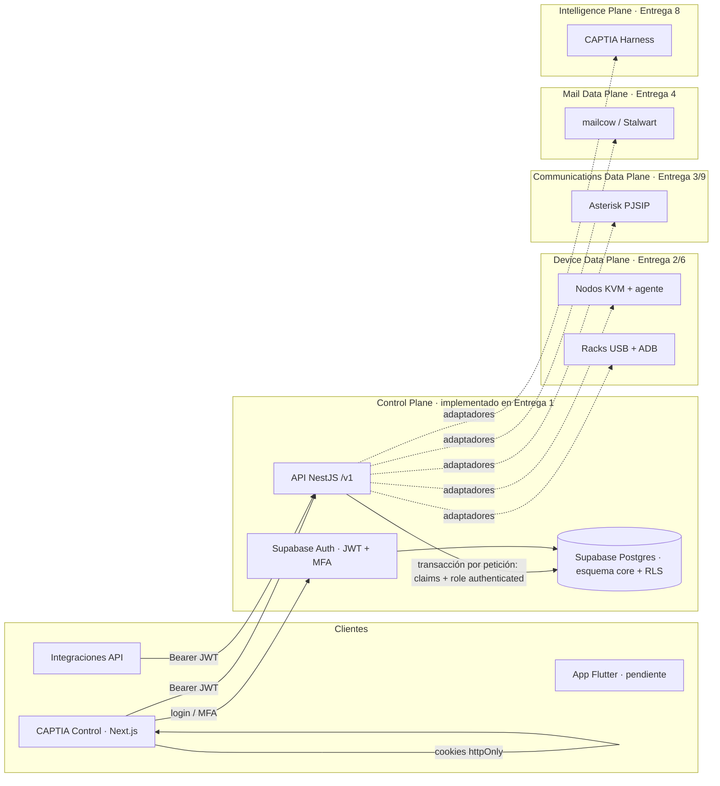
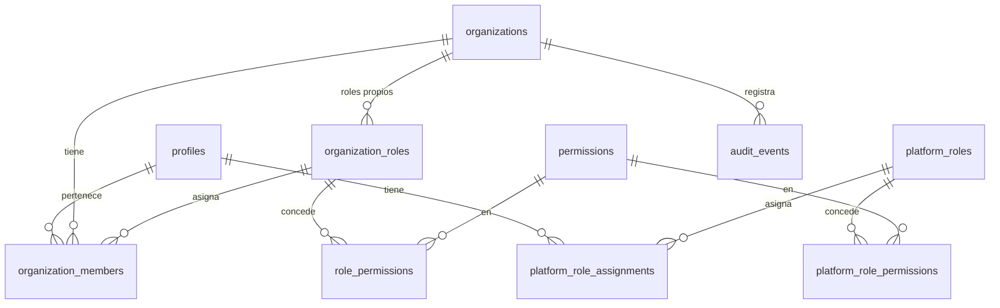

# Arquitectura general

## Planos

| Plano | Responsabilidad | Estado |
|---|---|---|
| Control | Auth, organizaciones, usuarios, RBAC, auditoría, catálogo, API | **Implementado (Entrega 1)** |
| Device data | Hipervisor, instancias Android, ADB, streaming, volúmenes | Pendiente: requiere nodo KVM |
| Communications data | Asterisk, SIP/RTP, buzones de voz, CDR | Pendiente |
| Mail data | SMTP/IMAP, buzones, antispam, webmail | Pendiente: requiere dominio propio |
| Intelligence | Agentes con permisos y aprobación humana | Pendiente |

Regla: el plano de control guarda el **estado deseado**; solo el plano de datos (agentes, PBX,
servidor de correo) confirma el **estado observado**. La UI muestra el observado.

## Flujo de una petición autenticada

1. El panel envía el token de acceso (de su cookie `httpOnly`) como `Authorization: Bearer`.
2. `AuthGuard` verifica el JWT (JWKS o HS256), emisor, audiencia, expiración y rol.
3. `RateLimitGuard` aplica la cuota del usuario.
4. `CoreService` abre una transacción, fija `request.jwt.claims` y `role authenticated`.
5. Lecturas: `select` sobre tablas con RLS. Escrituras: funciones `core.*` que comprueban permiso,
   MFA (`aal2`) y escriben `core.audit_events` en la misma transacción.
6. Errores → `application/problem+json` con código estable.

## Modelo de datos (Entrega 1)

Tablas: `permissions`, `platform_roles`, `platform_role_permissions`, `platform_role_assignments`,
`organizations`, `organization_roles`, `role_permissions`, `organization_members`, `profiles`,
`audit_events`, `service_catalog`, `feature_flags`, `idempotency_keys`.
Definición completa: `supabase/migrations/20261119000100_core.sql`.
